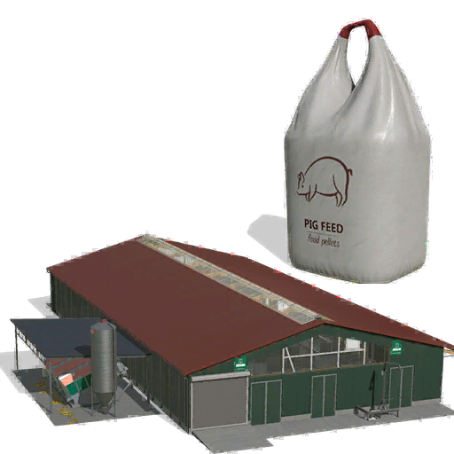

# ModHub upload: Pig Barn With Feeding Robot (GEA)

What to enter in the GIANTS ModHub upload form for this mod. Each text box below has a copy button on GitHub.



**Mod Icon (512x512):** [`icon_512.png`](icon_512.png)

| Field | Value |
|-------|-------|
| Title English | Pig Barn With Feeding Robot (GEA) |
| Title German | Schweinestall mit Fütterungsroboter (GEA) |
| Title French | Porcherie avec robot d'alimentation (GEA) |
| Version | `1` `0` `0` `13` |
| Author | DTM Mods, Fennell |
| Manufacturer | Rudolf Hörmann |
| Category 1 | Placeable > Animal Pens |
| Category 2 | Not Set |
| Category 3 | Not Set |

## Title English
```text
Pig Barn With Feeding Robot (GEA)
```

## Title German
```text
Schweinestall mit Fütterungsroboter (GEA)
```

## Title French
```text
Porcherie avec robot d'alimentation (GEA)
```

## Description English
```text
The big Rudolf Hörmann barn with the GEA feeding robot, converted for pigs. Fill the robot's four hoppers with crops and the barn is fed from them every hour, in the right shares for the pig diet.

- Silo outside: base feed (corn or sorghum), 50%
- Grain bin: grains (wheat or barley), 25%
- Protein bin: protein (soybeans, canola or sunflowers), 20%
- Root crop bin: root crops (potatoes or sugar beet), 5%
- Each hopper takes every crop of its group, including the ones your map adds; an empty hopper only stops its own share
- Bought-in Pig Food and loose pig crops go straight into the feed alley, like TMR in the cow barn
- Straw bales dropped in the feed alley go into the straw storage; manure is stored in the barn and loads at the slurry point
- The info box shows how long the feed, each hopper and the straw last, with a warning when one runs low or empty
- Up to 1,500 pigs, automatic water supply
- Price: 800,000, upkeep 700 per day

Changelog 1.0.0.12:
- New line in the barn's info box, Feed alley lasts: how long the feed in the alley lasts without the hoppers.
- The barn's saved data is registered properly, so the game no longer warns about it in the log.
```

## Description German
```text
Der große Rudolf-Hörmann-Stall mit dem GEA-Fütterungsroboter, umgebaut für Schweine. Füll die vier Behälter des Roboters mit Feldfrüchten, und der Stall wird jede Stunde daraus gefüttert, in den richtigen Anteilen für das Schweinefutter.

- Silo draußen: Grundfutter (Mais oder Sorghum), 50 %
- Getreidebehälter: Getreide (Weizen oder Gerste), 25 %
- Eiweißbehälter: Eiweiß (Sojabohnen, Raps oder Sonnenblumen), 20 %
- Hackfruchtbehälter: Hackfrüchte (Kartoffeln oder Zuckerrüben), 5 %
- Jeder Behälter nimmt alle Früchte seiner Gruppe an, auch die deiner Karte; ein leerer Behälter stoppt nur seinen eigenen Anteil
- Gekauftes Schweinefutter und lose Futterfrüchte kommen direkt in den Futtergang, wie TMR im Kuhstall
- Strohballen im Futtergang kommen ins Strohlager; Mist wird im Stall gelagert und an der Güllestelle geladen
- Die Infobox zeigt, wie lange das Futter, jeder Behälter und das Stroh reichen, mit Warnung, wenn etwas knapp oder leer wird
- Bis zu 1.500 Schweine, automatische Wasserversorgung
- Preis: 800.000, Unterhalt 700 pro Tag

Changelog 1.0.0.12:
- Neue Zeile in der Infobox des Stalls, Futtergang reicht: wie lange das Futter im Futtergang ohne die Behälter reicht.
- Die gespeicherten Daten des Stalls sind richtig registriert, das Spiel warnt im Log nicht mehr davor.
```

## Description French
```text
La grande étable Rudolf Hörmann avec le robot d'alimentation GEA, transformée pour les porcs. Remplissez les quatre trémies du robot avec vos récoltes : la porcherie est nourrie toutes les heures, dans les bonnes proportions pour la ration des porcs.

- Silo extérieur : aliment de base (maïs ou sorgho), 50 %
- Trémie à céréales : céréales (blé ou orge), 25 %
- Trémie à protéines : protéines (soja, colza ou tournesol), 20 %
- Trémie à tubercules : pommes de terre ou betteraves sucrières, 5 %
- Chaque trémie prend toutes les cultures de son groupe, y compris celles de votre carte ; une trémie vide n'arrête que sa propre part
- L'aliment pour porcs acheté et les récoltes en vrac vont directement dans le couloir d'alimentation, comme la RTM dans l'étable
- Les balles de paille déposées dans le couloir vont au stock de paille ; le fumier est stocké dans la porcherie et se charge au point de lisier
- La fenêtre d'info indique combien de temps durent l'aliment, chaque trémie et la paille, avec une alerte quand l'un d'eux baisse ou est vide
- Jusqu'à 1 500 porcs, eau automatique
- Prix : 800 000, entretien 700 par jour

Changelog 1.0.0.12 :
- Nouvelle ligne dans la fenêtre d'info : combien de temps dure l'aliment du couloir sans les trémies.
- Les données sauvegardées de la porcherie sont bien enregistrées ; le jeu n'affiche plus d'avertissement dans le log.
```

## Before uploading

- Built from base-game content: the barn is GIANTS' Rudolf Hörmann cow barn, and the zip ships an edited copy of the base-game GEA feeding robot model (`placeables/pigFeedRobot.i3d.shapes`, 6.9 MB). ModHub accepts edited base-game assets, but check that the conversion counts as new content and that no unchanged game file is shipped that could be loaded from `$data`.
- Translations in the mod itself: English only. The title, description and shop texts have no German or French.
