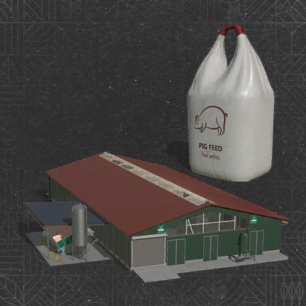

# ModHub upload: Pig Barn With Feeding Robot (GEA)

What to enter in the GIANTS ModHub upload form for this mod. Each text box below has a copy button on GitHub.



**Mod Icon (512x512):** [`icon_512.png`](icon_512.png)

| Field | Value |
|-------|-------|
| Title English | Pig Barn With Feeding Robot (GEA) |
| Title German | Schweinestall mit Fütterungsroboter (GEA) |
| Title French | Porcherie avec robot d'alimentation (GEA) |
| Version | `1` `0` `0` `13` |
| Author | DTM Mods, Fennell |
| Manufacturer | Rudolf Hörmann |
| Category 1 | Placeable > Animal Pens |
| Category 2 | Not Set |
| Category 3 | Not Set |

## Title English
```text
Pig Barn With Feeding Robot (GEA)
```

## Title German
```text
Schweinestall mit Fütterungsroboter (GEA)
```

## Title French
```text
Porcherie avec robot d'alimentation (GEA)
```

## Description English
```text
Category: Animal Pens
Price: $800,000
Monthly upkeep: $700
Production recipe: base feed 50% + grains 25% + protein 20% + root crops 5% -> pig food, mixed by the GEA robot every hour
Configurations: colour (13 colours), solar panels (+$187,500)

The big Hörmann barn with the GEA feeding robot, converted for pigs.

Fill the robot's four hoppers and the barn is fed from them every hour:
- Silo outside: base feed (corn or sorghum), 50%
- Grain bin: grains (wheat or barley), 25%
- Protein bin: protein (soybeans, canola or sunflowers), 20%
- Root crop bin: root crops (potatoes or sugar beet), 5%
Each hopper takes every crop of its group, including the ones your map adds, and nothing else.
Each group feeds its own share, so an empty hopper only stops that part of the diet.

Bought-in Pig Food is tipped straight into the feed alley inside the barn, like TMR in the cow barn. The robot only mixes crops.
Loose pig crops can go into the feed alley too.

Manure is stored in the barn and loads at the slurry point. A manure heap nearby adds storage.

Straw bales can be dropped in the feed alley; they go into the straw storage.
The barn's info box shows how long the feed in the alley, each hopper and the straw last, and you get a warning when one runs low (under a month left) or empty.

Pigs: up to 1500
Food: 800,000 l
Straw: 1,000,000 l
Liquid manure: 1,500,000 l
Manure: 1,200,000 l
Protein bin: 400,000 l
Root crop bin: 120,000 l
Grain bin: 500,000 l
Base feed silo: 1,000,000 l
Robot mixer: 30,000 l
Automatic water supply
```

## Description German
```text
Kategorie: Tiergehege
Preis: 800.000 €
Monatliche Unterhaltskosten: 700 €
Produktionsrezepte: Grundfutter 50 % + Getreide 25 % + Eiweiß 20 % + Hackfrüchte 5 % -> Schweinefutter, stündlich vom GEA-Roboter gemischt
Konfigurationen: Farbe (13 Farben), Solarmodule (+187.500 €)

Der große Hörmann-Stall mit dem GEA-Fütterungsroboter, umgebaut für Schweine.

Füll die vier Vorratsbehälter des Roboters, und der Stall wird jede Stunde daraus gefüttert:
- Silo außen: Grundfutter (Mais oder Sorghum), 50 %
- Getreidebehälter: Getreide (Weizen oder Gerste), 25 %
- Eiweißbehälter: Eiweiß (Sojabohnen, Raps oder Sonnenblumen), 20 %
- Hackfruchtbehälter: Hackfrüchte (Kartoffeln oder Zuckerrüben), 5 %
Jeder Behälter nimmt jede Frucht seiner Gruppe an, auch die, die deine Karte hinzufügt, und sonst nichts.
Jede Gruppe liefert ihren eigenen Anteil, ein leerer Behälter stoppt also nur diesen Teil der Ration.

Zugekauftes Schweinefutter wird direkt in den Futtergang im Stall gekippt, wie TMR im Kuhstall. Der Roboter mischt nur Feldfrüchte.
Lose Früchte für Schweine können ebenfalls in den Futtergang.

Mist wird im Stall gelagert und an der Gülle-Ladestelle geladen. Ein Misthaufen in der Nähe erweitert das Lager.

Strohballen können im Futtergang abgeladen werden; sie kommen ins Strohlager.
Die Infobox des Stalls zeigt, wie lange das Futter im Futtergang, jeder Behälter und das Stroh reichen, und du bekommst eine Warnung, wenn etwas knapp wird (weniger als ein Monat übrig) oder leer ist.

Schweine: bis zu 1500
Futter: 800.000 l
Stroh: 1.000.000 l
Gülle: 1.500.000 l
Mist: 1.200.000 l
Eiweißbehälter: 400.000 l
Hackfruchtbehälter: 120.000 l
Getreidebehälter: 500.000 l
Grundfuttersilo: 1.000.000 l
Robotermischer: 30.000 l
Automatische Wasserversorgung
```

## Description French
```text
Catégorie : Enclos pour animaux
Prix : 800 000 €
Entretien mensuel : 700 €
Recette de production : aliment de base 50 % + céréales 25 % + protéines 20 % + tubercules 5 % -> aliment pour porcs, mélangé toutes les heures par le robot GEA
Configurations : couleur (13 couleurs), panneaux solaires (+187 500 €)

La grande étable Hörmann avec le robot d'alimentation GEA, transformée pour les porcs.

Remplissez les quatre trémies du robot, et la porcherie est nourrie à partir d'elles toutes les heures :
- Silo extérieur : aliment de base (maïs ou sorgho), 50 %
- Trémie à céréales : céréales (blé ou orge), 25 %
- Trémie à protéines : protéines (soja, colza ou tournesol), 20 %
- Trémie à tubercules : tubercules (pommes de terre ou betteraves sucrières), 5 %
Chaque trémie accepte toutes les cultures de son groupe, y compris celles qu'ajoute votre carte, et rien d'autre.
Chaque groupe fournit sa propre part : une trémie vide n'arrête donc que cette partie de la ration.

L'aliment pour porcs acheté se déverse directement dans le couloir d'alimentation de la porcherie, comme la RTM dans l'étable à vaches. Le robot ne mélange que des récoltes.
Les récoltes en vrac pour porcs peuvent aussi aller dans le couloir d'alimentation.

Le fumier est stocké dans la porcherie et se charge au point de lisier. Un tas de fumier à proximité ajoute du stockage.

Les balles de paille peuvent être déposées dans le couloir d'alimentation ; elles vont dans le stock de paille.
La fenêtre d'info de la porcherie indique combien de temps durent l'aliment du couloir, chaque trémie et la paille, et vous êtes averti quand l'un d'eux baisse (moins d'un mois restant) ou est vide.

Porcs : jusqu'à 1 500
Aliment : 800 000 l
Paille : 1 000 000 l
Lisier : 1 500 000 l
Fumier : 1 200 000 l
Trémie à protéines : 400 000 l
Trémie à tubercules : 120 000 l
Trémie à céréales : 500 000 l
Silo d'aliment de base : 1 000 000 l
Mélangeur du robot : 30 000 l
Approvisionnement en eau automatique
```

## Before uploading

- Screenshots for the upload: [`modhub/screenshots/`](screenshots) (1600x900, unedited in-game shots, `1.jpg` first).
- Built from base-game content: the barn is GIANTS' Rudolf Hörmann cow barn, and the zip ships an edited copy of the base-game GEA feeding robot model (`placeables/pigFeedRobot.i3d.shapes`, 6.9 MB). ModHub accepts edited base-game assets, but check that the conversion counts as new content and that no unchanged game file is shipped that could be loaded from `$data`.
- Translations in the mod itself: English only. The title, description and shop texts have no German or French.
